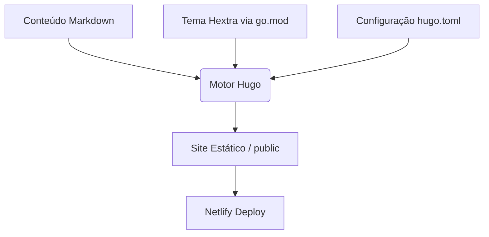

# Blog Hugo (AkitaOnRails Style) Design

**Spec**: `.specs/features/blog-hugo-akita/spec.md`
**Status**: Draft

---

## Architecture Overview

O blog utilizará a arquitetura de Site Estático baseada em Hugo, com o tema Hextra injetado via Go Modules. O build local será feito via CLI do Hugo (Extended) e o build remoto ocorrerá na Netlify, configurado para cachear os recursos e módulos Go.

---

## Code Reuse Analysis

### Existing Components to Leverage

Como este é um projeto novo na raiz, não há componentes preexistentes para reutilizar. O reuso ocorre a partir da estrutura base do tema Hextra.

| Component | Location | How to Use |
|-----------|----------|------------|
| Tema Hextra | Repositório Remoto (Go Module) | Importado no `hugo.toml` e `go.mod` |

### Integration Points

| System | Integration Method |
|--------|--------------------|
| Netlify | Via arquivo `netlify.toml` na raiz do repositório, mapeando o comando de build `hugo` e diretório de publicação `public/`. |

---

## Components

### Arquivos de Configuração do Hugo

- **Purpose**: Configurar o ambiente do blog, idioma, metadados e importar o tema Hextra.
- **Location**: `hugo.toml` e `go.mod` na raiz.
- **Interfaces**: Configurações padrão do Hugo (ex: `baseURL`, `title`, `module.imports`).
- **Dependencies**: CLI do Go e Hugo (Extended).
- **Reuses**: Hextra default settings.

### Estrutura de Conteúdo (Content)

- **Purpose**: Armazenar os posts do blog e a página inicial em Markdown.
- **Location**: `content/_index.md` e `content/posts/`.
- **Interfaces**: Markdown Frontmatter (YAML/TOML).
- **Dependencies**: O motor de renderização do Hugo.
- **Reuses**: Layouts nativos do Hextra.

### Configuração de Deploy (Netlify)

- **Purpose**: Instruir a Netlify sobre como buildar o site e o que cachear.
- **Location**: `netlify.toml` na raiz.
- **Interfaces**: Sintaxe de configuração da Netlify (`[build]`, `[build.environment]`).
- **Dependencies**: Netlify Build System.
- **Reuses**: N/A

---

## Error Handling Strategy

| Error Scenario | Handling | User Impact |
|----------------|----------|-------------|
| Build local falha por falta do Go | Mensagem no CLI exigindo a instalação do Go | Desenvolvedor não consegue iniciar o ambiente |
| Hugo Extended não instalado | Erro de compilação SCSS (`error: failed to transform resource`) | Desenvolvedor precisará baixar a versão apropriada |
| Falha no cache da Netlify | O Netlify tentará baixar tudo do zero novamente (Fallback) | Aumento do tempo de build, mas sem impacto no site live |

---

## Tech Decisions (only non-obvious ones)

| Decision | Choice | Rationale |
|----------|--------|-----------|
| Gerenciamento de Tema | Go Modules (`hugo mod init`) | É a recomendação atual e oficial do Hugo e do projeto AkitaOnRails, permitindo controle fácil de versão sem os problemas de Git Submodules. |
| Formato de Configuração | `.toml` (`hugo.toml`) | Padrão mais comum na documentação do Hugo, com leitura fácil para configurações estáticas. |
