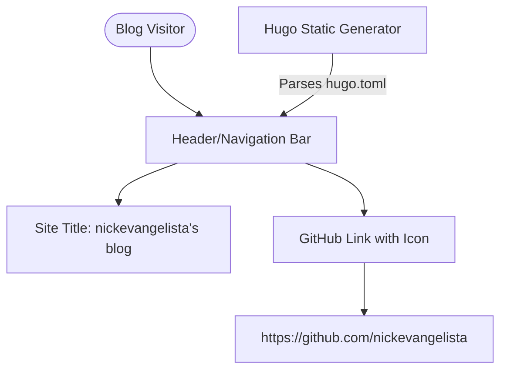

# Nickevangelista Blog Customization Design

**Spec**: `.specs/features/nickevangelista-blog-customization/spec.md`
**Status**: Approved

---

## Architecture Overview

The blog utilizes the **Hugo** static site generator and the **Hextra** theme (imported via Go modules). 
Branding and top navigation menus in Hugo are driven by the static configuration file `hugo.toml`.
Hextra reads the `title` variable for header branding and processes `[[menu.main]]` arrays to render navbar options, supporting custom attributes like SVGs via its `params` dictionary (e.g., `params = { icon = "github" }`).

---

## Code Reuse Analysis

### Existing Components to Leverage

| Component | Location | How to Use |
| --- | --- | --- |
| Site Configuration | `hugo.toml` | Update parameters and add the main menu layout. |
| Theme Engine | Go Module `github.com/imfing/hextra` | Use built-in support for rendering menus with SVG icons. |

### Integration Points

| System | Integration Method |
| --- | --- |
| GitHub | Standard outbound hyperlink in the top navigation bar. |

---

## Components

### Hugo Configuration Component

- **Purpose**: Defines site global parameters, module imports, and top-level navigation items.
- **Location**: `hugo.toml`
- **Interfaces**:
  - `title`: Site-wide branding string. Must support quotes for apostrophes.
  - `[[menu.main]]`: Array defining the top navigation menu.
- **Dependencies**: Hugo Extended build and Go modules to resolve `github.com/imfing/hextra`.
- **Reuses**: Hextra standard module parameters.

---

## Error Handling Strategy

| Error Scenario | Handling | User Impact |
| --- | --- | --- |
| TOML syntax error | Build script fails with compilation error. | Site doesn't compile/serve. |
| Missing/incorrect SVG icon name | Theme defaults to rendering text-only menu links or blank icon. | GitHub menu item renders only as text link ("GitHub"). |
| Broken hyperlink | Validation check fails. | Visitor hits 404 or external error page. |

---

## Tech Decisions

| Decision | Choice | Rationale |
| --- | --- | --- |
| String quoting for title | Double quotes: `"nickevangelista's blog"` | TOML string keys with apostrophes must be enclosed in double quotes or single quotes to avoid parse errors. |
| Parameter format for menu item | `params = { icon = "github" }` | Inline tables in TOML are cleaner and less prone to breaking the parent table context than block-level sections. |
