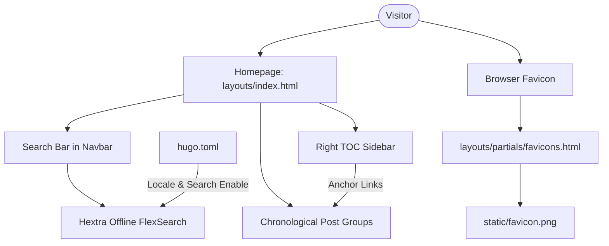

# Search and Grouping Design

**Spec**: `.specs/features/search-and-grouping/spec.md`
**Status**: Draft

---

## Architecture Overview

The feature uses **Hugo** static site layout overriding to customize the homepage list rendering and table of contents. Theme configurations in `hugo.toml` enable Hextra's built-in search and localized dates.

---

## Code Reuse Analysis

### Existing Components to Leverage

| Component | Location | How to Use |
| --------- | -------- | ---------- |
| Hextra CSS & Layout Skeleton | Go Module `github.com/imfing/hextra` | Overridden template `layouts/index.html` extends `baseof.html` using the `"main"` block. |
| Table of Contents Styling | Theme CSS classes (`hextra-toc`, etc.) | Replicate identical markup structures on the home page TOC navigation sidebar. |
| FlexSearch Integration | Theme search JS assets | Enabled automatically via menu configurations. |

### Integration Points

| System | Integration Method |
| ------ | ------------------ |
| Local Static Assets | Favicon PNG copied to the static files directory to be served at the `/favicon.png` path. |

---

## Components

### 1. Site Configuration overrides
- **Purpose**: Configure site localization to Portuguese and enable search menu.
- **Location**: `hugo.toml`
- **Interfaces**:
  - `languageCode = 'pt-br'`
  - `defaultContentLanguage = 'pt'`
  - `[[menu.main]]` entry with `params.type = "search"` and `weight = 2`.
- **Dependencies**: Hugo Extended build compiler.

### 2. Homepage Custom Layout
- **Purpose**: Chronologically group and render posts, and output custom TOC.
- **Location**: `layouts/index.html`
- **Interfaces**:
  - `{{ define "main" }}` block.
  - Queries `site.RegularPages` filtered to section `"posts"`.
  - Grouping function `.GroupByDate "2006-01"`.
  - Localized date formatter `time.Format`.
  - Custom HTML rendering matching Hextra's CSS classes for grid layout and TOC.
- **Dependencies**: Tailwind classes embedded in Hextra theme stylesheet.

### 3. Favicon Overrides
- **Purpose**: Force HTML pages to load the custom favicon png.
- **Location**: `layouts/partials/favicons.html`
- **Interfaces**: Overrides the theme's built-in `favicons.html` template.
- **Dependencies**: Copying user's PNG file to `static/favicon.png`.

---

## Error Handling Strategy

| Error Scenario | Handling | User Impact |
| -------------- | -------- | ----------- |
| Dates not translated | Ensure locale is defined in configuration (`defaultContentLanguage = 'pt'`) and compilation environment supports it. | Months display in English (e.g., "June" instead of "Junho"). |
| Broken TOC Anchors | Ensure formatting pattern for IDs matches between `h2` elements and sidebar `a` tags (both using `urlize` formatting). | Sidebar link doesn't scroll page when clicked. |
| Duplicate ID anchors | If multiple groups generate same string key, ensure unique values. Date format `"2006-January" | urlize` guarantees uniqueness for monthly granularity. |

---

## Tech Decisions

| Decision | Choice | Rationale |
| -------- | ------ | --------- |
| TOC implementation | Hardcoded loop over post date groups in `layouts/index.html` | Homepage list dynamically aggregates posts, so Hugo's static `.TableOfContents` parser (which only reads the raw Markdown content of `_index.md`) is empty. A custom loop replicates identical styling and markup for seamless integration. |
| Locale settings | `pt-br`/`pt` in configuration | Ensures Hugo's `time.Format` function outputs localized month names natively without complex template logic. |
| Favicon size/format | PNG format at `static/favicon.png` | Standard image format compatible with all modern browsers. Simplified override layout references it directly. |
